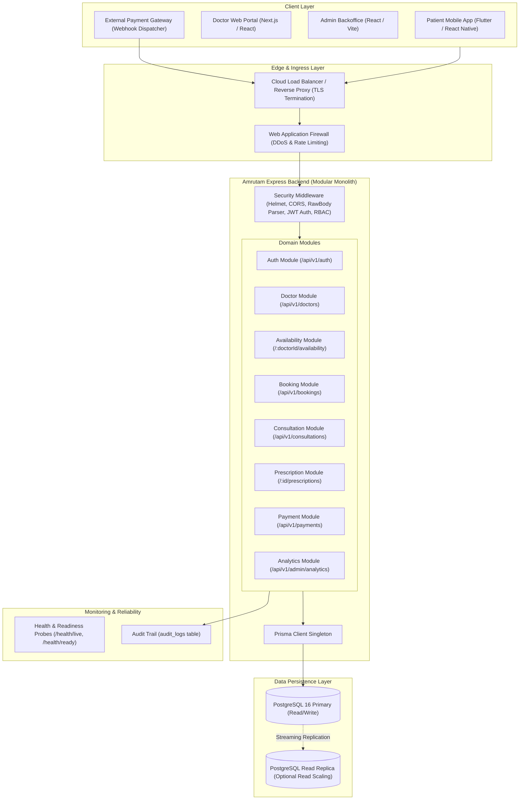
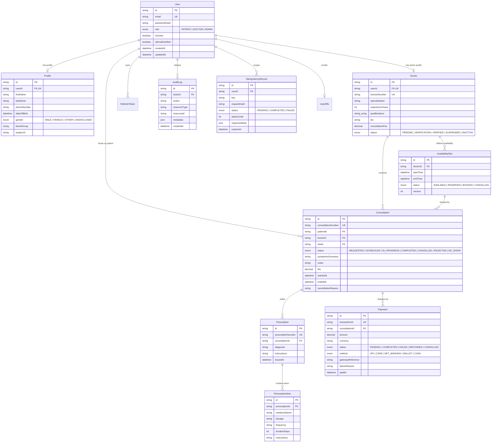
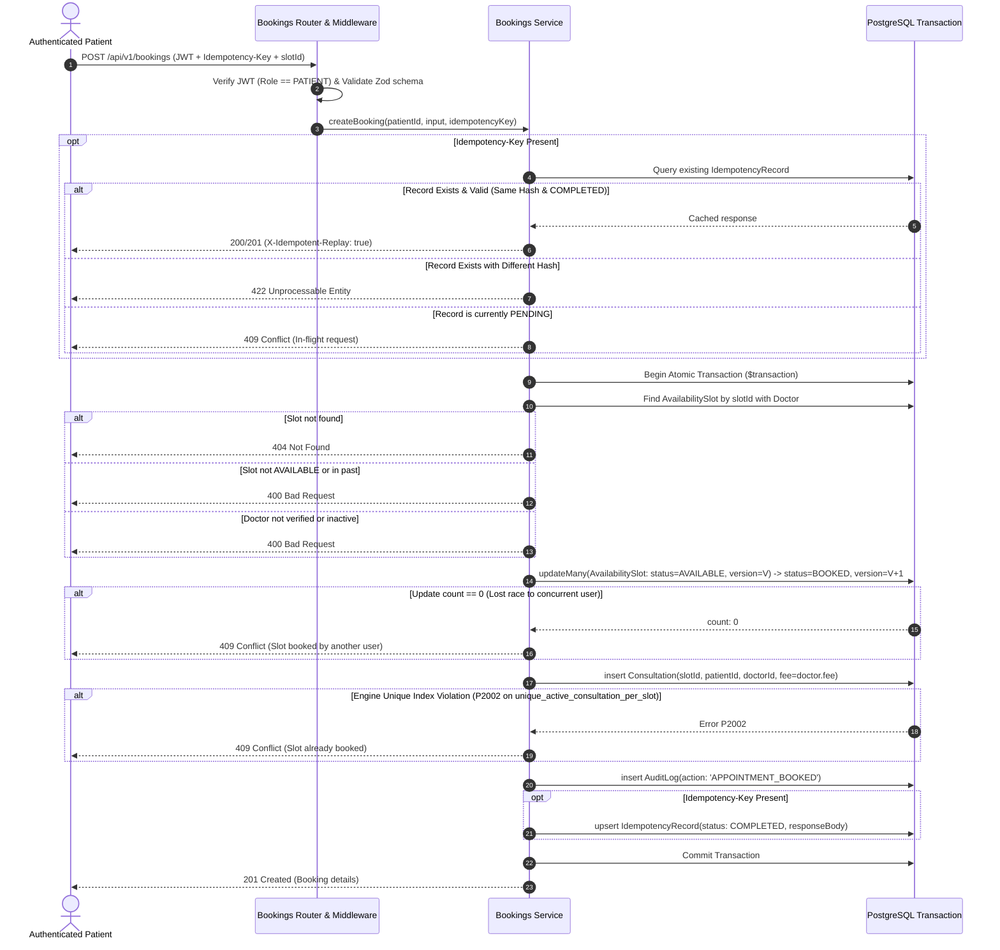
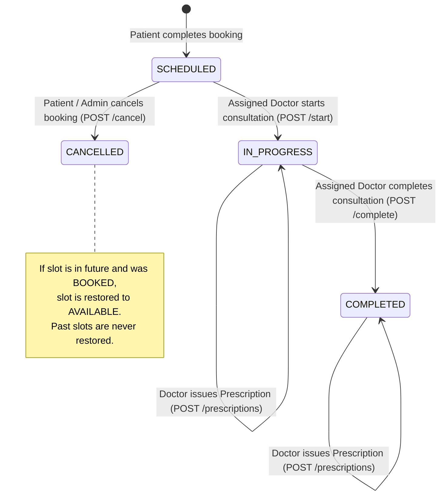
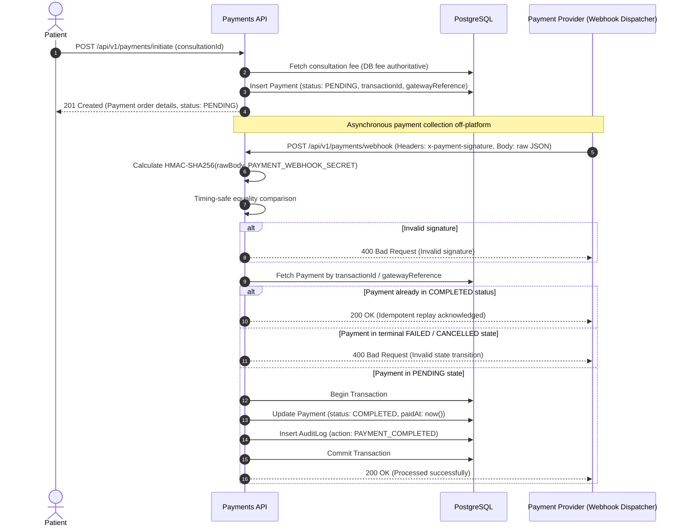

# Amrutam Telemedicine Backend — Architecture & System Design Document

**Document Version:** 1.0.0  
**Target Platform:** Amrutam Telemedicine Platform  
**Architecture Pattern:** Modular Monolith (Layered Domain Architecture)  
**Primary Stack:** Node.js 20 LTS, TypeScript 5.7, Express 4.21, PostgreSQL 16, Prisma ORM 5.22, Zod 3.24, Vitest 3.0  

---

## 1. System Overview & Architectural Decisions

### 1.1 Executive Summary
Amrutam Telemedicine is a clinical and Ayurvedic telehealth platform facilitating remote patient consultations, verified doctor availability scheduling, transactional appointment bookings with strict double-booking prevention, medical prescription issuance, payment lifecycle reconciliation, and administrative KPI analytics.

### 1.2 Core Architectural Decisions

| Decision | Selection | Rationale & Trade-offs |
|---|---|---|
| **Architectural Style** | **Modular Monolith** | Avoids the premature operational complexity, distributed transaction pitfalls, and network latency of microservices while maintaining strict internal module isolation through well-defined directory boundaries and single-responsibility services. |
| **Type Safety & Contracts** | **Strict TypeScript & Zod** | End-to-end compile-time and runtime type safety. Zod schemas validate every inbound HTTP payload (params, query strings, request bodies) before touching controller handlers. |
| **Data Persistence** | **PostgreSQL 16 + Prisma ORM** | ACID transactions with multi-version concurrency control (MVCC). Leverages native PostgreSQL features including `btree_gist` exclusion constraints, partial unique indexes, and decimal numeric types for financial and chronological integrity. |
| **Authentication & AuthZ** | **Stateless JWT + RBAC** | Lightweight, stateless authorization tokens signed with HMAC SHA-256 (`Role: PATIENT, DOCTOR, ADMIN`). Server-side ownership guards prevent cross-tenant enumeration. |
| **Concurrency Guard** | **Optimistic Locking + Engine-Level Partial Index** | Prevents race conditions during concurrent appointment bookings via two independent defense layers: application-level `version` counters and PostgreSQL partial unique index `unique_active_consultation_per_slot`. |
| **API Idempotency** | **Idempotency-Key via SHA-256 Hashing** | Protects mutation endpoints (`POST /api/v1/bookings`) from duplicate execution during client retries or network drops, scoped to the authenticated patient. |

---

## 2. System Architecture & Component Diagram

The following architecture diagram illustrates the end-to-end topology from external clients to the containerized deployment environment:



---

## 3. Modular Monolith Architecture & Module Boundaries

The codebase is organized into domain modules within `src/modules/`. Each module enforces strict separation of concerns across four standard layers:

```text
src/modules/<module-name>/
├── <module>.validation.ts   # Inbound request schemas (Zod)
├── <module>.service.ts      # Pure business logic, transactional database calls
├── <module>.controller.ts   # HTTP request mapping, status codes, error forwarding
├── <module>.routes.ts       # Express router definitions, middleware binding
└── index.ts                 # Clean public barrel exports
```

### Module Boundaries & Responsibilities

1. **Authentication (`src/modules/auth`)**:
   - Manages user registration, credential hashing with `bcryptjs` (salt cost 10), email normalization, JWT token generation, and `/me` identity introspection.
   - Enforces the business invariant that public registration is strictly restricted to `Role.PATIENT`.
2. **Doctor Management (`src/modules/doctors`)**:
   - Manages doctor onboarding (admin-only), medical license verification, specialization filtering, fee structures, and public directory listings.
3. **Doctor Availability (`src/modules/availability`)**:
   - Manages doctor availability slots. Enforces chronological constraints (`startTime < endTime`), duration limits (15–240 minutes), advance window bounds (max 90 days), and non-overlapping slot exclusion.
4. **Appointment Booking (`src/modules/bookings`)**:
   - Transactional booking orchestration, slot reservation, optimistic concurrency version checking, PostgreSQL partial unique index conflict translation, and idempotency key lifecycle.
5. **Consultation & Prescription (`src/modules/consultations`, `src/modules/prescriptions`)**:
   - Clinical lifecycle state machine (`SCHEDULED` ➔ `IN_PROGRESS` ➔ `COMPLETED`).
   - Prescription issuance with structured medicines, dosages, frequencies, and duration intervals in days.
6. **Payment Lifecycle (`src/modules/payments`)**:
   - Server-side fee derivation, transaction initialization (`PENDING`), cryptographic HMAC SHA-256 webhook signature validation over raw buffers, and idempotent state reconciliation.
7. **Admin Analytics (`src/modules/analytics`)**:
   - Administrative dashboards, platform KPIs, bounded chronological trend aggregation, and doctor performance tracking using database-level aggregations without leaking patient health information.

---

## 4. Entity-Relationship (ER) Diagram

The data model is derived from `prisma/schema.prisma` and enforced by PostgreSQL 16:



---

## 5. Appointment Booking Transaction, Optimistic Locking & Idempotency

### 5.1 Concurrency Defense Architecture
When high patient demand collides on popular doctor availability slots, booking systems face race conditions. Amrutam implements a **Double-Layer Concurrency Defense**:

1. **Layer 1: Optimistic Concurrency Control (OCC)**:
   The `AvailabilitySlot` model contains an integer `version` field. When booking:
   ```typescript
   const updateSlotResult = await tx.availabilitySlot.updateMany({
     where: { id: slot.id, status: SlotStatus.AVAILABLE, version: slot.version },
     data: { status: SlotStatus.BOOKED, version: { increment: 1 } }
   });
   if (updateSlotResult.count === 0) {
     throw new ConflictError('The requested availability slot was just booked by another user');
   }
   ```
2. **Layer 2: Database Partial Unique Index**:
   PostgreSQL enforces an engine-level partial unique index:
   ```sql
   CREATE UNIQUE INDEX "unique_active_consultation_per_slot"
   ON "consultations" ("slot_id")
   WHERE "status" NOT IN ('CANCELLED', 'REJECTED');
   ```
   Even if two transactions run simultaneously under read-committed isolation, PostgreSQL locks the index tuple for the slot. The second transaction triggers a `P2002` unique constraint violation, which is converted into HTTP `409 Conflict`.

### 5.2 Idempotency Handling & TTL Verification
Clients provide an `Idempotency-Key` header (e.g. UUID). The backend computes a deterministic SHA-256 hash of the canonical request body and scopes it to the patient:
- **First Request**: A `PENDING` record is inserted with a 24-hour expiration timestamp (`expiresAt = Date.now() + 24h`). If processing succeeds, the record transitions to `COMPLETED` and caches the response.
- **Identical Repeated Request**: When `expiresAt > new Date()`, hashes match and status is `COMPLETED` ➔ replays cached response with `X-Idempotent-Replay: true`.
- **Tampered Payload with Same Key**: Hashes mismatch within the 24-hour validity window ➔ rejects with `422 Unprocessable Entity`.
- **Concurrent In-Flight Request**: Record is in `PENDING` state within the validity window ➔ returns `409 Conflict`.
- **Expired Keys**: If an idempotency record has exceeded its 24-hour TTL (`expiresAt <= new Date()`), the lookup check ignores the expired record and overwrites it with a fresh `PENDING` state. Automated background row eviction (e.g. via `pg_cron` or periodic scheduled vacuum) is recommended for database storage hygiene.



---

## 6. Consultation & Prescription Lifecycle

Consultations follow a clinical state machine managed by assigned doctors or administrators:



- **Starting a Consultation**: Only the assigned doctor (verified via `doctorProfile.userId === req.user.id`) or an `ADMIN` can start a consultation. Updates `startedAt = now()`.
- **Completing a Consultation**: Only in-progress consultations can be completed. Updates `endedAt = now()`.
- **Issuing Prescriptions**: Must be `IN_PROGRESS` or `COMPLETED`. Prescriptions contain diagnosis, general instructions, and structured medicine items (dosage, frequency, duration in days). Created atomically in a Prisma `$transaction`.

---

## 7. Payment Webhook Verification & State Management

Amrutam implements asynchronous, provider-agnostic payment processing with strict cryptographic signature verification:



### Limitations & Production Requirements
- **Development Mock Provider**: In `NODE_ENV=development` or `test`, a mock provider generates deterministic order references. Initiation always leaves the payment in `PENDING` state until an authentic webhook event is received.
- **Production Guard**: If `NODE_ENV=production`, the mock provider is blocked from initializing. A real merchant gateway (such as Razorpay or Stripe) must supply `PAYMENT_KEY_ID` and `PAYMENT_WEBHOOK_SECRET`.

---

## 8. Caching & Asynchronous Processing Strategy

To maintain engineering integrity, we explicitly distinguish between implemented functionality and proposed scaling enhancements:

### 8.1 Implemented Functionality
- **Database Eager Loading**: Relational queries use selective nested `select` and `include` clauses, completely avoiding N+1 queries for public doctor directories, availability slot lookups, and patient booking lists.
- **Database Indexes**: Dedicated B-tree and composite indexes on `consultations(patient_id, created_at)`, `consultations(doctor_id, status)`, `availability_slots(doctor_id, start_time, status)`, and `payments(transaction_id)`.
- **Outbox Pattern Schema**: The database schema includes an `OutboxEvent` table (`id, event_type, aggregate_type, aggregate_id, payload, status`) to support atomic database writes coupled with domain event emission. *(Note: The table is established in PostgreSQL migrations, but event emission and background polling workers are not currently active in the Express application).*

### 8.2 Proposed Future Improvements (Not Implemented in Current Codebase)
- **Distributed Caching (Redis)**: Redis is not currently installed or imported in `package.json`. In-memory or Redis-based distributed caching is proposed to cache public doctor profiles and frequently requested doctor availability slots with a 60-second TTL, invalidated when availability slots are created or booked.
- **Background Job Queue (BullMQ / Redis)**: Offload external email/SMS notifications and webhook retries from the HTTP request cycle.
- **Outbox Worker**: Implement a transactional polling or CDC (Change Data Capture via Debezium) worker that reads `outbox_events` and publishes them to an event bus (RabbitMQ / Apache Kafka).

---

## 9. Observability, Health Checks & Centralized Error Handling

### 9.1 Health Check Endpoints
- **Liveness Probe (`GET /health/live`)**: Returns `200 OK` with process uptime and ISO timestamp. Used by Kubernetes/Docker orchestrators to detect process crashes.
- **Readiness Probe (`GET /health/ready`)**: Performs a bounded database connectivity probe (`SELECT 1` with a 2-second timeout). Returns `200 OK` when PostgreSQL is responsive and `503 Service Unavailable` when database connectivity fails.

### 9.2 Error Handling & Information Disclosure
- **Operational Exceptions**: Custom `AppError` subclasses (`BadRequestError` [400], `UnauthorizedError` [401], `ForbiddenError` [403], `NotFoundError` [404], `ConflictError` [409], `UnprocessableEntityError` [422]).
- **Information Disclosure Prevention**: In production (`NODE_ENV=production`), internal unhandled errors return `{ success: false, error: { message: "Internal Server Error" } }`. Stack traces, raw SQL queries, and database driver error codes are never exposed to clients.
- **Audit Trails**: Critical mutations (`BOOKING_CREATED`, `APPOINTMENT_CANCELLED`, `CONSULTATION_STARTED`, `CONSULTATION_COMPLETED`, `PRESCRIPTION_ISSUED`, `PAYMENT_COMPLETED`) are recorded in the `audit_logs` table with actor IDs and resource identifiers.

---

## 10. Scaling Strategy for 100,000 Daily Consultations

### 10.1 Workload Analysis
- **100,000 consultations/day** equates to:
  - Average booking rate: $\approx 1.16$ bookings/second.
  - Peak booking rate (assuming $5\times$ peak load during morning slots): $\approx 5.8$ bookings/second.
  - Read-to-write ratio: Estimated $20:1$ (patients browsing doctors and schedules), yielding $\approx 116$ read requests/second during peak hours.
  - Daily database growth: $\approx 100,000$ consultations, $\approx 100,000$ payments, and $\approx 200,000$ audit logs per day ($\approx 150\text{ MB/day}$, or $\approx 55\text{ GB/year}$).

### 10.2 Architectural Targets vs. Current Status

> [!WARNING]
> The performance metrics below represent architectural engineering targets for production deployment. They have **not** yet been certified via production load testing.

| Metric | Target | Proposed Technical Mechanism |
|---|---|---|
| **P95 Read Latency** | $< 200\text{ ms}$ | Read replica routing, connection pooling (PgBouncer), selective indexing, and Redis caching. |
| **P95 Write Latency** | $< 500\text{ ms}$ | Atomic single-roundtrip Prisma transactions, exclusion constraints via GiST, and connection pooling. |
| **Availability** | $99.95\%$ ($\le 4.38\text{ hrs}$ downtime/year) | Multi-AZ PostgreSQL failover, horizontal pod autoscaling (HPA), and zero-downtime rolling deploys. |

### 10.3 Scaling Blueprint
1. **Stateless App Scaling**: Run Express application pods in Docker/Kubernetes with Horizontal Pod Autoscaling (HPA) targeting 70% CPU utilization.
2. **Database Connection Pooling**: Deploy **PgBouncer** in transaction-pooling mode between application instances and PostgreSQL to manage up to 5,000 concurrent client connections without exhausting PostgreSQL process limits.
3. **Database Read/Write Splitting**: Route analytical dashboards (`/api/v1/admin/analytics`) and public doctor searches (`/api/v1/doctors`) to a read replica, leaving the primary database unburdened for booking and payment transactions.
4. **Table Partitioning**: Implement PostgreSQL range partitioning on `audit_logs` and `consultations` by month (`createdAt`) to preserve index traversal efficiency as dataset sizes exceed 10 million rows.

---

## 11. Backup, Disaster Recovery & High Availability

### 11.1 Backup Architecture
- **Continuous Archiving**: PostgreSQL Write-Ahead Log (WAL) archiving to durable object storage (e.g. AWS S3 / Google Cloud Storage) with versioning and object locks.
- **Physical Snapshots**: Daily full automated volume snapshots retained for 30 days.
- **Point-in-Time Recovery (PITR)**: Enables recovery to any arbitrary second within the past 14 days, minimizing data loss to near zero ($RPO < 5\text{ minutes}$).

### 11.2 Recovery Objectives
- **Recovery Point Objective (RPO)**: $< 5\text{ minutes}$ (maximum acceptable data loss during catastrophe).
- **Recovery Time Objective (RTO)**: $< 30\text{ minutes}$ (time required to spin up a replacement standby database cluster from automated snapshots and replayed WAL archives).

---

## 12. Security, Privacy & Deployment Hardening

1. **Patient Health Information (PHI) Protection**:
   - Symptoms, notes, and medical diagnoses are accessible only to the owning patient, the assigned doctor, or an administrator.
   - Prescriptions cannot be viewed by unauthorized third parties; route parameters enforce server-side identity verification.
2. **Network & Transport Security**:
   - All inbound connections must terminate with TLS 1.3.
   - HTTP response headers enforced by `helmet` (HSTS, X-Content-Type-Options, Frameguard).
   - Strict CORS policy restricts unauthorized web cross-origin requests.
3. **Container Security**:
   - Docker container runs with an unprivileged non-root user (`USER node`).
   - Multi-stage build discards TypeScript source files, compiler tools, and development dependencies in the final production runner image.
