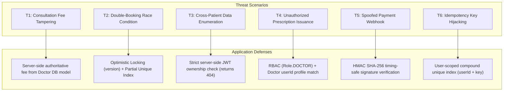

# Amrutam Telemedicine Backend — Security Checklist & Threat Model

**Document Version:** 1.0.0  
**Target Environment:** Node.js 20 LTS, Express, PostgreSQL 16, Prisma ORM  
**Evaluation Date:** October 28, 2026  

---

## 1. Security Controls Verification Matrix

Each security control is strictly classified based on tangible code inspection and automated test evidence:

| # | Security Control Domain | Current Implementation Status | Code Evidence & Verification Details |
|---|---|---|---|
| **1** | **Password Hashing & Registration** | **Implemented and verified** | Passwords hashed using `bcryptjs` with salt cost 10 in `AuthService.register`. Public registration is strictly restricted to `Role.PATIENT`. Verified in `tests/auth.test.ts`. |
| **2** | **JWT Validation & Expiry** | **Implemented and verified** | Stateless JWTs verified with HMAC SHA-256 using `env.JWT_SECRET`. Expiration checked via `jwt.verify`. Tested in `tests/auth.test.ts`. |
| **3** | **JWT Secret Rotation** | **Partially implemented** | Multi-key signature rotation is not built into the application layer; secret rotation currently requires a coordinated process restart or rolling update with new environment variables. |
| **4** | **RBAC & Authorization** | **Implemented and verified** | Reusable `authorize(...roles)` middleware enforces access by role. Tested across doctor onboarding (admin only), availability management (owning doctor or admin), booking (patient only), and analytics (admin only). |
| **5** | **Server-Side Ownership Enforcement** | **Implemented and verified** | Patient ID and Doctor ID are derived from the verified JWT, never trusted from client request bodies. Cross-tenant access attempts return `404 Not Found` to prevent account enumeration. Verified in `tests/bookings.test.ts`, `tests/consultations.test.ts`, and `tests/payments.test.ts`. |
| **6** | **Input Validation & Injection Prevention** | **Implemented and verified** | All route parameters, query parameters, and request bodies are validated using strict Zod schemas (`validateRequest`, `validateQuery`, `validateParams`). Parameterized queries in Prisma ORM prevent SQL injection. Tested across all test suites. |
| **7** | **Rate Limiting & Brute-Force Defense** | **Not implemented at application layer / operational setup** | Application returns uniform timing responses for auth failures, but HTTP request throttling is not implemented in Express middleware. Rate limiting must be provisioned at the API Gateway or reverse proxy (e.g. Nginx, Cloudflare, or AWS WAF). |
| **8** | **Patient Health Information (PHI) Privacy** | **Implemented and verified** | Symptoms, medical notes, diagnoses, and prescriptions are selectively exposed only to the patient and assigned doctor. Analytics endpoints strip all identifiable health information. Verified in `tests/analytics.test.ts`. |
| **9** | **Encryption in Transit** | **Implemented but not independently verified** | TLS termination is configured for cloud load balancer and ingress proxies. Container is prepared for HTTPS behind reverse proxy with HSTS headers via `helmet()`. |
| **10** | **Encryption at Rest** | **Not implemented / requires operational setup** | Requires operational configuration of PostgreSQL storage volume encryption (e.g. AWS KMS / LUKS) and encrypted database backups. |
| **11** | **Environment Secrets & Key Management** | **Implemented and verified** | Environment variables are validated on startup using Zod in `src/config/env.ts`. Placeholders used in version control (`.env.example`), real secrets excluded via `.gitignore`. |
| **12** | **Webhook Cryptographic Signature Verification** | **Implemented and verified** | Webhook notifications require valid HMAC SHA-256 signatures over raw request buffers (`req.rawBody`), verified using constant-time equality (`crypto.timingSafeEqual`). Verified in `tests/payments.test.ts`. |
| **13** | **Webhook Replay Protection & Idempotency** | **Implemented and verified** | Replayed webhook events for already completed or failed transactions are handled idempotently without re-triggering business logic or duplicate state transitions. Verified in `tests/payments.test.ts`. |
| **14** | **Booking Concurrency & Double-Booking Attacks** | **Implemented and verified** | Double-layer defense: Application-level optimistic concurrency control (`AvailabilitySlot.version`) and PostgreSQL engine-level partial unique index (`unique_active_consultation_per_slot`). Verified in `tests/bookings.test.ts`. |
| **15** | **Audit Logging & Sensitive Data Redaction** | **Implemented and verified** | Crucial domain operations (`BOOKING_CREATED`, `APPOINTMENT_CANCELLED`, `CONSULTATION_STARTED`, `CONSULTATION_COMPLETED`, `PRESCRIPTION_ISSUED`, `PAYMENT_COMPLETED`) record entries in `audit_logs`. Passwords and secrets are omitted from audit payloads. |
| **16** | **Dependency Scanning & Vulnerability Management** | **Partially implemented** | CI workflow executes `npm ci` to enforce lockfile integrity. Automated CVE scanning (e.g. `npm audit`, Snyk, or Dependabot) is recommended as a future CI gate. |
| **17** | **Database Backups & Point-in-Time Recovery** | **Not implemented / requires operational setup** | Requires production infrastructure orchestration: automated WAL archiving and daily EBS/cloud storage snapshots. |
| **18** | **Container Deployment Hardening** | **Implemented and verified** | Multi-stage Docker build discards development dependencies and compilers. Production container executes under an unprivileged user (`USER node`). |

---

## 2. Threat Model

### 2.1 Critical Assets
1. **Patient Identifiable Information (PII)**: Patient legal names, email addresses, phone numbers, avatars.
2. **Protected Health Information (PHI)**: Clinical symptoms summaries, doctor private consultation notes, diagnoses, medical prescriptions, and dosage instructions.
3. **Financial Transaction Records**: Payment transaction IDs, gateway references, consultation fees, and refund statuses.
4. **Physician Credentials**: Medical license numbers, qualification certificates, verification statuses.
5. **System Credentials & Secrets**: JWT signing secret, payment gateway webhook secrets, database connection credentials.

### 2.2 Trust Boundaries
- **Boundary 1 (External Web / Client to Reverse Proxy)**: Untrusted public Internet to TLS-terminated ingress.
- **Boundary 2 (Reverse Proxy to Express Application)**: Authenticated HTTP requests carrying JWT bearer tokens and raw webhook payloads.
- **Boundary 3 (Express Application to PostgreSQL Database)**: Trusted internal network connection over authenticated Prisma connection pool.
- **Boundary 4 (External Payment Gateway to Webhook Endpoint)**: Unauthenticated public HTTP POST requests bearing HMAC SHA-256 signature headers.

### 2.3 Threat Actors
- **External Opportunistic Attackers**: Automated scanners attempting SQL injection, path traversal, brute-force auth attacks, or dictionary attacks.
- **Malicious Patients**: Authenticated users attempting to view other patients' consultations, tamper with consultation fees, or book multiple slots simultaneously.
- **Rogue / Unauthorized Doctors**: Authenticated physicians attempting to start or complete consultations assigned to another doctor, or generate fraudulent prescriptions.
- **Network / Replay Attackers**: Adversaries attempting to intercept or replay booking requests or webhook notifications.

---

### 2.4 Threat Analysis, Impact & Mitigations

| Threat ID | Threat Description | Attacker & Vector | Technical Impact | Implemented Mitigation | Residual Risk |
|---|---|---|---|---|---|
| **T1: Fee Tampering** | Patient attempts to pay a lower consultation fee by sending a modified amount in the request body. | Malicious Patient (`POST /api/v1/payments/initiate` or `POST /api/v1/bookings`). | Financial loss; revenue discrepancy. | The application strictly derives consultation fees from the database doctor profile (`consultation.fee`). Client-supplied amounts are ignored. | Negligible. |
| **T2: Concurrent Double-Booking** | Two patients attempt to book the exact same availability slot simultaneously. | Competing Patients making concurrent HTTP requests. | Inconsistent booking state; double-booked clinical slots. | Double-layer defense: Application-level optimistic locking (`version`) plus engine-level partial unique index `unique_active_consultation_per_slot`. Conflicting request receives HTTP 409. | Negligible. |
| **T3: Cross-Patient Enumeration** | Patient attempts to access another patient's consultation or booking by guessing UUIDs. | Malicious Patient (`GET /api/v1/consultations/:id`). | PHI data breach; unauthorized disclosure. | Server-side ownership verification derives patient identity from the verified JWT. Mismatched IDs return `404 Not Found` rather than `403` to prevent ID enumeration. | Minimal (relies on JWT secrecy). |
| **T4: Fraudulent Prescription** | Patient or unassigned physician attempts to generate or issue prescriptions. | Patient or unassigned Doctor (`POST /api/v1/consultations/:id/prescriptions`). | Medical fraud; compliance violation. | Endpoint is protected with `authorize(Role.DOCTOR, Role.ADMIN)` and verifies that `consultation.doctorId` matches the doctor profile of `req.user.id`. Status must be `IN_PROGRESS` or `COMPLETED`. | Minimal. |
| **T5: Webhook Signature Forgery** | Attacker sends fake payment notifications to mark unpaid consultations as completed. | External Adversary (`POST /api/v1/payments/webhook`). | Unearned medical services provided; financial loss. | HMAC SHA-256 calculated over raw request buffer (`req.rawBody`) using `env.PAYMENT_WEBHOOK_SECRET` and verified via `crypto.timingSafeEqual`. Tampered requests receive HTTP 400. | Low (depends on webhook secret secrecy). |
| **T6: Idempotency Hijacking** | Patient reuses an idempotency key with a different booking payload to manipulate transactions. | Malicious Patient (`POST /api/v1/bookings` with `Idempotency-Key`). | State corruption; inconsistent transaction logs. | Keys are scoped by patient ID via database compound unique index `@@unique([userId, key])`. SHA-256 hash of payload is validated; payload mismatches are rejected with HTTP 422. | Negligible. |

---

## 3. Operational Security Recommendations for Production

1. **API Gateway & Rate Limiting**: Deploy an API gateway (e.g. AWS API Gateway, Cloudflare, or Kong) enforcing IP-based and token-based rate limiting (100 req/min per IP, 30 req/min for `/api/v1/auth/login`).
2. **Key Management Service (KMS)**: Replace static `.env` file credentials in production with AWS Secrets Manager, HashiCorp Vault, or Google Cloud Secret Manager.
3. **Database Network Isolation**: Host PostgreSQL in a private subnet inaccessible from the public Internet, reachable only through the application security group or a bastion host.
4. **Log Sanitization**: Ensure reverse proxies and application logging frameworks filter out HTTP Authorization headers, cookies, and patient medical notes from disk logs.
